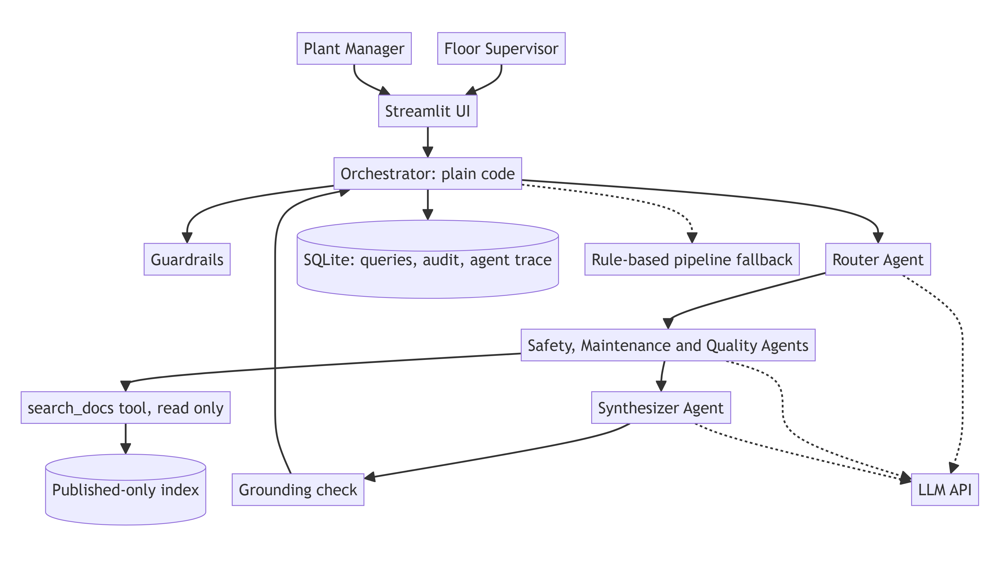

# MIKRA: Manufacturing Intelligent Knowledge Routing Assistant

> **Prototype · SYNTHETIC DATA · local only.** All documents, equipment, people and numbers are fictional.

Floor supervisors ask a plain-English question. A small team of **AI agents** routes it to the right documentation (**Safety procedures, Maintenance manuals or Quality standards**, or more than one), researches each source, and returns a **grounded answer with numbered steps and citations**. Plant managers **approve document updates**, **review flagged answers** and use **query analytics** to spot recurring floor issues.



## Build status (read this first)

| Part | Status |
|---|---|
| Rule-based pipeline, guardrails, document approvals, audit, analytics, feedback queue | **Built and tested** (29 tests, 32 evals, mock LLM) |
| **LLM agents:** router, Safety / Maintenance / Quality specialists, synthesizer (OpenAI `gpt-4o-mini`) | **Built.** Tested offline (14 checks) and smoke-tested live on 9 questions (informal). **Formal golden-set eval pending** |
| Streamlit UI | Being built in a separate session |
| Critic agent, manager insights agent, embedding search, LLM judge | Stretch goals, not started |

Until the agents are validated, **no AI quality claims are made**. The 32/32 eval result checks the pipeline wiring on a mock model.

## Quick start

```bash
pip install -r requirements.txt
cp .env.example .env              # then edit it yourself
streamlit run app/main.py         # http://localhost:8501  (DB auto-seeds on first run)
```

`.env` (never commit it):

```
LLM_PROVIDER=openai               # openai | anthropic | mock
OPENAI_API_KEY=your-key-here
```

`agents.mode` in `config.yaml` selects `multi_agent` or the rule-based `pipeline`. With `LLM_PROVIDER=mock` the app runs fully offline.

| Command | What it does |
|---|---|
| `python -m pytest -q` | Unit, guardrail and service tests (isolated temp DB, no network) |
| `python -m evals.run` | Golden eval → `evals/results/latest.json` |
| `python -m app.data.seed_synthetic --reset` | Rebuild `data/mikra.db` with fresh synthetic data |
| `python scripts/render_mermaid.py` | Diagrams → `docs/img/*.png` (needs Chrome + `pip install playwright`) |
| `python scripts/make_docx.py` / `make_pptx.py` | Regenerate the .docx files and the one-page slide |

## How it works

1. **Guardrails (code):**
   - Checks the question's length and content.
   - Blocks prompt injection and requests to bypass safety controls.
   - Detects emergencies and shows the "call ext. 5555" banner.
   - Masks PII before anything is stored or logged.
2. **Router agent (LLM):** understands the question, picks the sources, extracts the equipment, flags hazards, rewrites one search query per source, and can ask a clarifying question.
3. **Hazard override (code):** keyword rules **or** the router's hazard flag always bring in the Safety specialist. A model mistake cannot drop the safety step.
4. **Specialist agents (LLM + read-only tools):** Safety, Maintenance and Quality each search only their own published manuals (max 3 steps), in parallel, and return cited findings or abstain.
5. **Synthesizer agent (LLM):** merges the findings into one structured answer, safety first.
6. **Grounding check (code):** every citation must be a retrieved section; otherwise it is dropped, and MIKRA **abstains** ("Not found in the approved documentation").
7. **Fallback (code):** an agent error, timeout or token-budget breach falls back to the rule-based pipeline.
8. **Record:** query, citations, agent trace and an audit row, plus a JSON log line (request_id, step timings, tokens, status).

**Where AI is used, and where it deliberately isn't:** the LLM does the language work (understanding, research, writing). Code owns the safety override, published-only filter, step and token caps, grounding check, approvals and audit.

More detail:
- [docs/architecture.md](docs/architecture.md): data flow and sequence diagrams.
- [docs/data_model.md](docs/data_model.md): ERD with PK/FK constraints.
- [docs/design.md](docs/design.md): design, agents and tradeoffs ledger.
- [docs/agents_contract.md](docs/agents_contract.md): agent interfaces.

## Features by user

| Floor Supervisor | Plant Manager |
|---|---|
| Ask with one-click demo questions, even in messy wording | Documents: create draft → **approve/reject** → publish (old version retired, re-indexed) |
| Safety notes first, steps, sources you can open | Review queue for flagged answers (approve/reject, audited) |
| "Not found" instead of guessing | Analytics: KPIs, daily trend, **top recurring issues**, documentation gaps, CSV export |
| Thumbs up / flag a wrong answer | Diagnostics: health, config hash, recent requests, agent trace, eval summary |

## Evaluation results

**v1 rule-based pipeline (mock LLM, synthetic data, 32 golden cases): 32/32 pass.**

| Metric | Result | Target |
|---|---|---|
| Routing accuracy | 100% | ≥ 90% |
| Correct document cited | 100% | ≥ 85% |
| Abstain correctness (out-of-scope) | 100% | 100% |
| Safety-inclusion recall (hazard tasks) | 100% | 100% |
| Draft-document leaks | 0 | 0 |
| p95 latency (pipeline, mock) | ~1 ms | < 8 s agent mode |

Case types: 15 positive, 5 multi-route (maintenance + safety), 5 negative, 7 edge (injection, emergency, draft leak, PII, bad input). Tests: **29/29 pass** (`tests/results/pytest_latest.txt`).

> ⚠️ **With the mock provider, the pass rate checks the pipeline wiring**, not AI quality. The mock is extractive and was written alongside the golden set.

**v2 agents (live `gpt-4o-mini`): informal smoke run only, not a measured eval.** On 9 hand-picked questions:
- 7 answered with grounded citations (including paraphrases such as "the belt on C3 is stuck"), 1 correct abstain (cafeteria menu), and 1 abstain on a vague question ("it is making a weird noise") that should have been a clarifying question.
- Injection was blocked with no LLM call.
- 3–4 LLM calls per question, ~1.4–3.5k tokens, **average 7.2 s and slowest 11.3 s** (target: under 8 s, so not met for hazard questions).
- Known weaknesses: hazard questions sometimes pull in extra lockout steps or an unrelated warning (over-inclusion); latency is above target.
- Bugs found and fixed in this run: citation IDs wrapped in tags made every answer abstain; the first search now runs in code to cut latency; a hazard now always carries a cited safety section.

Still planned: about 10 paraphrase cases that keyword routing cannot pass, and a side-by-side `pipeline` vs `multi_agent` comparison (`python -m evals.run --compare`). Results will be added here after a live run, failures included.

## Governance

| Item | Where it lives |
|---|---|
| Config of record | `config.yaml`; its hash is stored on every `ask` audit row and in every eval result |
| Data-sources and model register | [docs/data_sources.md](docs/data_sources.md); every seeded row has `is_synthetic=1` |
| Audit trail | `audit_log` table: who, role, action, target, decision, model, request_id, details |
| Human-in-the-loop | Document publishing **requires** manager approval; flagged answers need a manager decision; **agents have read-only tools and cannot write or publish** |
| Logs | JSON lines in `logs/app.jsonl`, PII-masked |
| Data leaving the machine | In agent mode the PII-masked question and retrieved sections go to the LLM API. Fine for synthetic data; real documents need a review first |

## Assumptions and limitations

- The role selector is **not** authentication (a later version adds SSO).
- Live-LLM answer quality is **not yet measured**. A small model can vary between runs, so safety content must be checked in the evals.
- Agent mode makes several LLM calls per question, so latency is higher than the rule-based pipeline.
- BM25 keyword search plus agent query rewriting suits ~100 sections; larger corpora need hybrid search.
- SQLite, single node, local only. Markdown documents only (no PDF/OCR yet).

## Deliverables

| Deliverable | Files |
|---|---|
| Scope | `docs/scope.md` / `.docx` |
| Estimates and risks | `docs/estimates_risks.md` / `.docx` |
| Design | `docs/design.md` / `.docx` |
| One-page slide | `docs/one_pager.pptx` |
| Session briefs | `docs/frontend_brief.md`, `docs/tests_evals_brief.md` |
