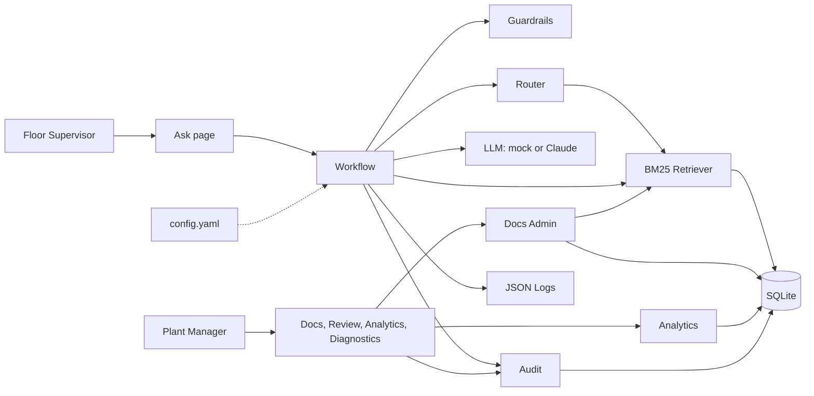
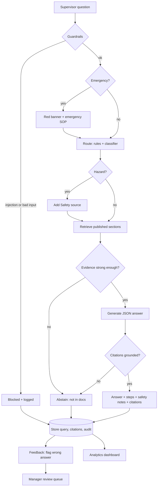
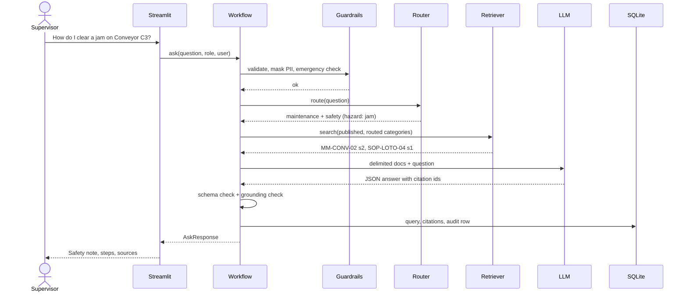

# MIKRA: Architecture

MIKRA (Manufacturing Intelligent Knowledge Routing Assistant) routes floor supervisors' questions to the right approved documentation and returns grounded, cited answers. All data is **synthetic**.

## 1. Solution architecture



| Component | Responsibility | Business "why" |
|---|---|---|
| Workflow | Fixed pipeline: guardrails → route → retrieve → answer → grounding check → store | Predictable latency and cost; no runaway agent loop on the floor |
| Guardrails | Length/type checks, prompt-injection and safety-bypass blocking, emergency detection, PII masking | Protects people and keeps logs compliant |
| Router | Keyword rules + classifier (LLM or mock), blended; hazard terms force the Safety source in | Explainable, auditable routing; safety is never missed |
| Retriever | BM25 over section-level chunks, **published documents only**, scoped to routed categories | Zero infrastructure; supervisors only see approved procedures |
| LLM Client | `mock` (deterministic, extractive) or `anthropic`; strict JSON output, retry, fallback | Demo works offline; swap to a live model with one setting |
| Docs Admin | Draft → manager approval → published (old version retired) → re-index | Only approved procedures reach the floor |
| Audit | Every ask, feedback, review and publish recorded with actor, decision, model, request_id | Traceability for EHS/quality audits |
| Analytics | KPIs, trends, recurring issues and documentation gaps computed from records | Managers spot recurring floor issues |

## 2. Data flow



## 3. Request sequence (one question, end to end)



## 4. File structure

```
mfg-doc-router/
├── app/
│   ├── main.py, pages/, ui/          Streamlit frontend (parallel session)
│   ├── services/                     interface contract used by the UI
│   │   ├── workflow.py               orchestration: ask(), health()
│   │   ├── router.py                 rules + classifier + safety override
│   │   ├── retriever.py              BM25 per category, published-only
│   │   ├── llm.py                    mock / anthropic, prompts, JSON output
│   │   ├── guardrails.py             validation, injection, emergency, PII
│   │   ├── docs_admin.py             draft → approve → publish lifecycle
│   │   ├── audit.py                  audit trail, feedback, review queue
│   │   └── analytics.py              KPIs, trends, gaps, CSV
│   ├── models/schemas.py             Pydantic contract
│   ├── data/db.py, seed_synthetic.py, corpus/*.md (18 synthetic docs + 1 draft)
│   └── observability/logging.py      JSON logs with request_id
├── evals/ golden.jsonl, run.py, results/
├── tests/                            pytest (29 tests)
├── docs/                             design, architecture, data model, scope, risks, slide
├── scripts/                          render_mermaid.py, make_docx.py, make_pptx.py
└── config.yaml, .env.example, requirements.txt, README.md
```
