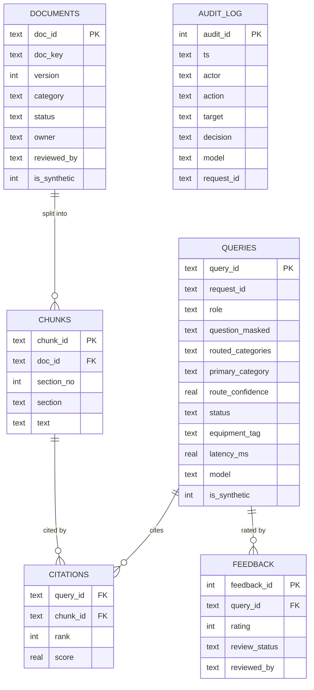

# MIKRA: Data Model

SQLite with `PRAGMA foreign_keys=ON` on every connection. CHECK constraints enforce allowed values. Every seeded row has `is_synthetic=1`.

| Table | Purpose | Key rules |
|---|---|---|
| documents | One row per document **version** | `UNIQUE(doc_key, version)`; status ∈ draft/published/rejected/retired; only one pending draft per doc_key; category can't change between versions |
| chunks | Section-level text (split on `## ` headings) | FK → documents; chunk_id = `<doc_id>#s<n>` so citations always point at an exact version and section |
| queries | Every question asked, including blocked and abstained ones | PII masked before storage; status ∈ ok/abstained/blocked/error |
| citations | Which sections supported each answer | Composite PK; FKs to queries and chunks |
| feedback | Thumbs up/down; thumbs-down goes to the manager review queue | review_status ∈ n/a/pending/approved/rejected; can't be resolved twice |
| audit_log | Who did what, when, with which model and request_id | Written in the same transaction as the action |
