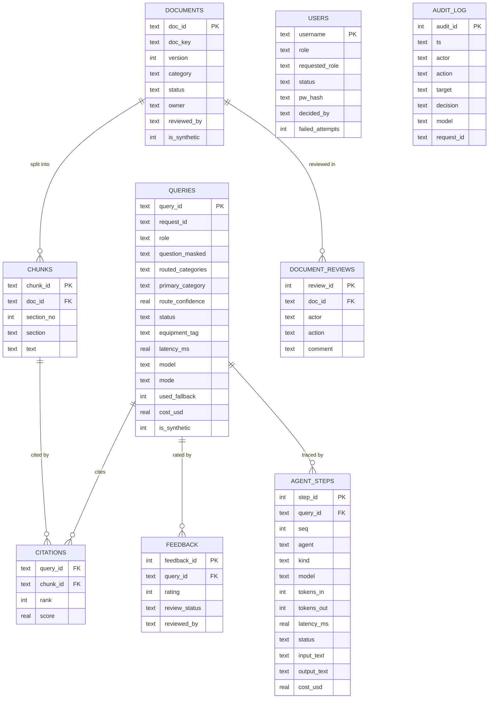

# MIKRA: Data Model

SQLite with `PRAGMA foreign_keys=ON` on every connection. CHECK constraints enforce allowed values. Every seeded row has `is_synthetic=1`.

> **Status:** all tables below are implemented. `AGENT_STEPS` stores every agent step (LLM call, tool call, guard) with its input and output, so any question can be replayed in the Traces page. `USERS` and `DOCUMENT_REVIEWS` back the administrator features. Older databases are upgraded in place on start (`db.MIGRATIONS`).

| Table | Purpose | Key rules |
|---|---|---|
| documents | One row per document **version** | `UNIQUE(doc_key, version)`; status ∈ draft/published/rejected/retired; only one pending draft per doc_key; category can't change between versions |
| chunks | Section-level text (split on `## ` headings) | FK → documents; chunk_id = `<doc_id>#s<n>` so citations point at an exact version and section |
| queries | Every question asked, including blocked and abstained ones | PII masked before storage; status ∈ ok/abstained/blocked/error |
| citations | Which sections supported each answer | Composite PK; FKs to queries and chunks |
| feedback | Thumbs up/down; thumbs-down goes to the manager review queue | review_status ∈ n/a/pending/approved/rejected; can't be resolved twice |
| agent_steps | One row per agent step: LLM call, tool call (including the pre-fetched first search) or guard | FK → queries (cascade); tokens, latency, status, cost, and the PII-masked input and output (clipped to 4,000 characters). Failed runs keep their partial steps and end with a `fallback_to_pipeline` guard |
| document_reviews | The review conversation on a draft: submit, advise, resubmit, comment, approve, reject | FK → documents; a draft whose last action is `advise` is shown as *Changes requested* |
| users | Accounts: role, approval status, salted password hash, lockout counters | role ∈ supervisor/manager/admin; status ∈ pending/approved/denied/disabled; passwords are PBKDF2-SHA256 hashes, never stored in clear |
| audit_log | Who did what, when, with which model and request_id | Written in the same transaction as the action. v2 adds the prompt version and `agents.mode` in `details` |
